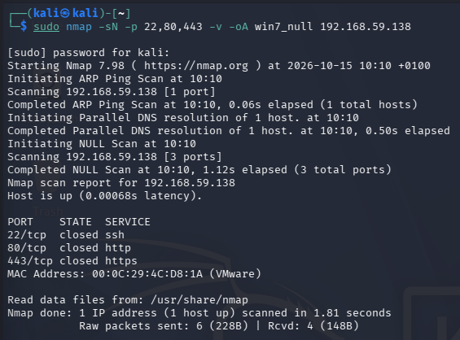
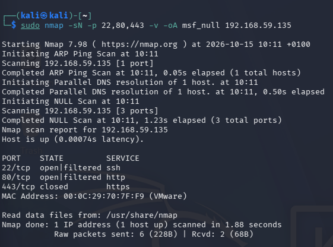
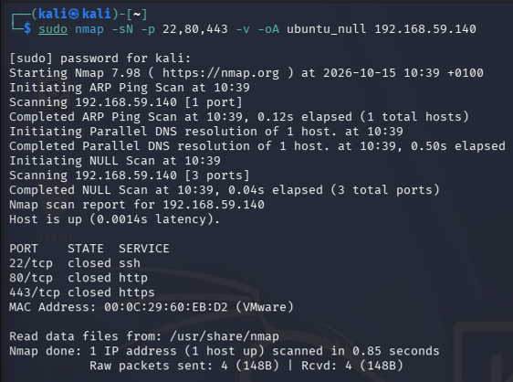
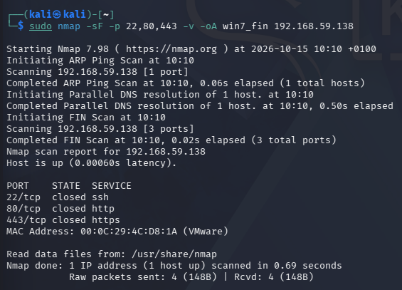
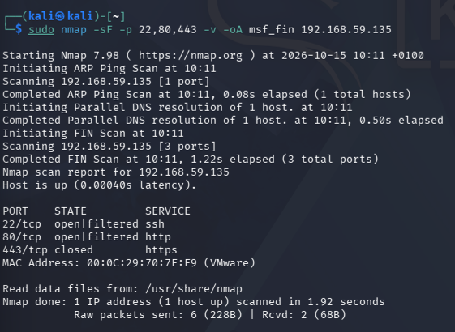
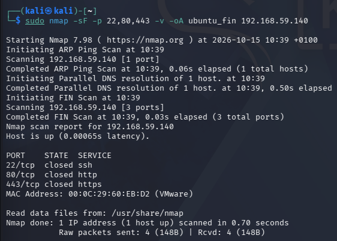

# Advanced Stealth Scans & RFC 793 Compliance

## Overview
This laboratory  covers advanced TCP stealth scanning techniques using Nmap, specifically focusing on Null (-sN) and FIN (-sF) scans across three distinct target operating systems (Windows 7, Metasploitable 2, and Ubuntu).

## Definition
Reconnaissance  refers to stealthy port scanning methods designed to evade basic packet filters by sending out-of-sequence TCP packets without standard flags.
While fingerprinting relies on analszing how different operating system TCP/IP stacks respond to non-standard TCP control flags to determine compliance with RFC 793 protocol standards.

---

## Command Breakdown Reference
The Nmap flags used during this  exercise are detailed below:

| Command | Description |
| :--- | :--- |
| sudo | Executes Nmap with administrative privileges |
| -sN | Performs a TCP Null scan where no TCP control flags are set |
| -sF | Performs a TCP FIN scan setting only the FIN (Finish) control flag |
| -p 22,80,443 | Restricts the scan target to specific TCP ports (SSH, HTTP, HTTPS) |
| -v | Enables verbose mode to display real-time scan output |
| -oA | Saves scan output in normal, XML, and grepable log formats |

---

## Task 1: Null Scanning (-sN)

### a. Windows 7 (192.168.59.138)
- **Command**: `sudo nmap -sN -p 22,80,443 -v -oA win7_null 192.168.59.138` (Recon command)
- **Result**: Nmap reported all scanned ports (22, 80, and 443) as closed on Windows 7, receiving TCP RST packets for each probe.
- **Meaning**: The target operating system active stack generates a TCP RST response for any out-of-sequence TCP packet without flags regardless of port state.
- **How Attackers Use This**: Attackers run Null scans to attempt bypassing stateless firewalls, though on Windows systems this produces a false negative result masking live services.
- **How to Patch**: Enable stateful packet inspection on host firewalls to block malformed TCP flag combinations.

Figure 3.1: Nmap Null scan output on Windows 7 showing all ports reported as closed.

### b. Metasploitable 2 (192.168.59.135)
- **Command**: `sudo nmap -sN -p 22,80,443 -v -oA msf_null 192.168.59.135` (Recon command)
- **Result**: Ports 22 (SSH) and 80 (HTTP) were reported as open|filtered because no responses were returned, while port 443 returned a TCP RST and showed as closed.
- **Meaning**: Metasploitable 2 follows RFC 793 standard behavior by silently ignoring Null packets sent to open listening ports while responding with RST to closed ports.
- **How Attackers Use This**: Attackers exploit this behavior to identify open listening services without generating log entries associated with standard TCP handshakes.
- **How to Patch**: Configure network firewalls to drop TCP packets that contain invalid flag combinations.

Figure 3.2: Nmap Null scan output on Metasploitable 2 displaying open|filtered ports.

### c. Ubuntu (192.168.59.140)
- **Command**: `sudo nmap -sN -p 22,80,443 -v -oA ubuntu_null 192.168.59.140` (Recon command)
- **Result**: The scan returned all target ports (22, 80, 443) as closed because no active web or SSH services were listening on these specific ports.
- **Meaning**: Ubuntu adheres strictly to RFC 793, returning TCP RST packets when Null probes land on closed ports.
- **How Attackers Use This**: Attackers determine that no services are listening on these tested ports without completing TCP handshakes.
- **How to Patch**: Keep unused ports closed and enforce host firewall rules using `ufw default deny incoming`.

Figure 3.3: Nmap Null scan output on Ubuntu demonstrating RFC compliant closed port responses.

---

## Task 2: FIN Scanning (-sF)

### a. Windows 7 (192.168.59.138)
- **Command**: `sudo nmap -sF -p 22,80,443 -v -oA win7_fin 192.168.59.138` (Recon command)
- **Result**: All scanned ports (22, 80, and 443) were reported as closed due to incoming TCP RST responses.
- **Meaning**: Windows 7 violates RFC 793 standards by responding with TCP RST packets to FIN probes regardless of whether the port is open or closed.
- **How Attackers Use This**: Attackers observe this behavior to perform OS fingerprinting, identifying the OS stack as Microsoft Windows due to non-compliant RST generation.
- **How to Patch**: Use modern Windows Defender Firewall rules to drop out-of-state TCP FIN packets.

Figure 3.4: Nmap FIN scan output on Windows 7 displaying closed port results.

### b. Metasploitable 2 (192.168.59.135)
- **Command**: `sudo nmap -sF -p 22,80,443 -v -oA msf_fin 192.168.59.135` (Recon command)
- **Result**: Ports 22 and 80 were identified as open|filtered due to no packet response, while port 443 returned a TCP RST indicating a closed state.
- **Meaning**: The Linux 2.6 kernel stack on Metasploitable 2 complies with RFC 793, dropping FIN packets on open ports while resetting closed ports.
- **How Attackers Use This**: Attackers differentiate open services from closed ports quietly without opening formal TCP sessions.
- **How to Patch**: Deploy intrusion prevention system (IPS) signatures to flag and drop standalone FIN packets.

Figure 3.5: Nmap FIN scan output on Metasploitable 2 showing open|filtered status.

### c. Ubuntu (192.168.59.140)
- **Command**: `sudo nmap -sF -p 22,80,443 -v -oA ubuntu_fin 192.168.59.140` (Recon command)
- **Result**: All scanned ports returned closed status based on received TCP RST packets.
- **Meaning**: Standard RFC 793 behavior on Ubuntu correctly sends RST for non-listening ports.
- **How Attackers Use This**: Attackers verify that no active services are exposed on these ports without full connection logging.
- **How to Patch**: Implement IPTables rules to log and drop non-SYN packets initiating connections.

Figure 3.6: Nmap FIN scan output on Ubuntu confirming closed port behavior.

---

## Realisation

The full TCP SYN scan conducted in previous task  identified 9 open ports on Windows 7 including SMB (445) and RPC (135), whereas Null and FIN scans incorrectly marked all ports closed.
- **What it means**: RFC 793 states that an open port receiving a TCP packet with no flags (Null) or only FIN set must drop the packet silently without responding, whereas closed ports must return a TCP RST packet. Windows 7 sends a TCP RST to all out-of-state Null/FIN scans regardless of port status, breaking RFC 793 rules.
- **How Attackers Can Use This**: Security analysts and attackers use this RFC non-compliance as an OS fingerprinting technique. When Null/FIN scans show all ports closed on a host known to have active services, the target can be fingerprinted as running a Microsoft Windows operating system.
- **How to Patch This**: Enforce perimeter network filtering to drop abnormal TCP flag combinations before they reach internal endpoint stacks.

---

## Summary

The table below summarises the stealth scan responses and RFC 793 compliance status observed across all three target operating systems:

| Target Host | IP Address | Null Scan (-sN) | FIN Scan (-sF) | RFC 793 Compliance Status |
| :--- | :--- | :--- | :--- | :--- |
| Metasploitable 2 | 192.168.59.135 | Ports 22 & 80: open\|filtered Port 443: closed | Ports 22 & 80: open\|filtered Port 443: closed | Compliant |
| Windows 7 | 192.168.59.138 | Ports 22, 80, 443: closed | Ports 22, 80, 443: closed | Non-Compliant (Sends RST for all ports) |
| Ubuntu | 192.168.59.140 | Ports 22, 80, 443: closed | Ports 22, 80, 443: closed | Compliant |

---

## How to Mitigate 

**While RFC 793 non-compliance on Windows provides an accidental defense by giving false closed results to stealth scans, relying on protocol non-compliance is not a proper defense strategy.**

The table below outlines modern countermeasures to mitigate stealth scan reconnaissance:

| Lab Finding & Vulnerability | Modern Defense & Countermeasure |
| :--- | :--- |
| Stealth Scan Port Enumeration (Null/FIN) | Deploy stateful firewalls (SPI) to drop TCP packets with invalid flag combinations (e.g., NULL or FIN-only without ACK). |
| RFC 793 Stack Fingerprinting | Implement Snort or Suricata IDS rules to detect and alert on out-of-sequence scan scans. |
| Open Service Exposure on Linux | Restrict service exposure using host firewalls and bind daemons strictly to local loopback if public access is not needed. |
| Legacy Windows Protocol Exposure | Enforce strict inbound firewall rules restricting access to SMB (445) and RPC (135) from external subnets. |
