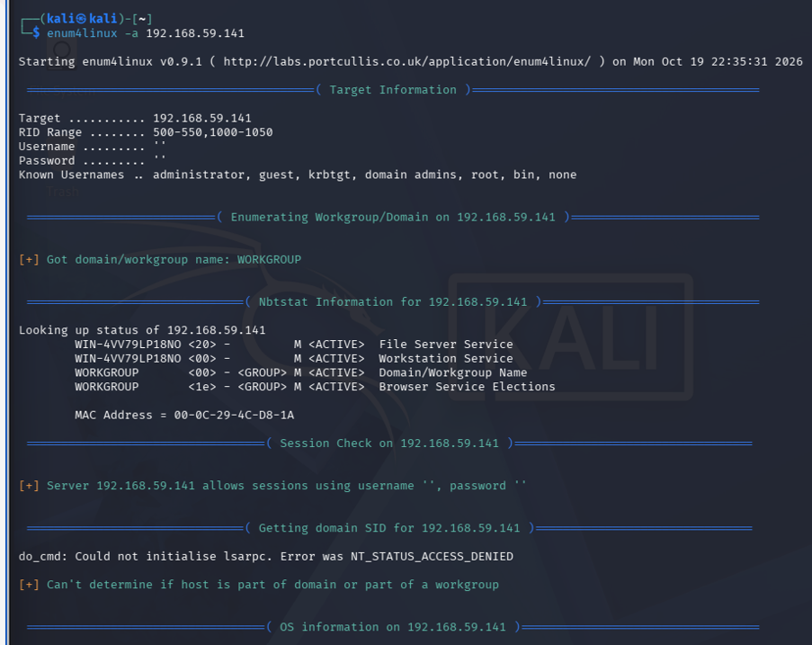
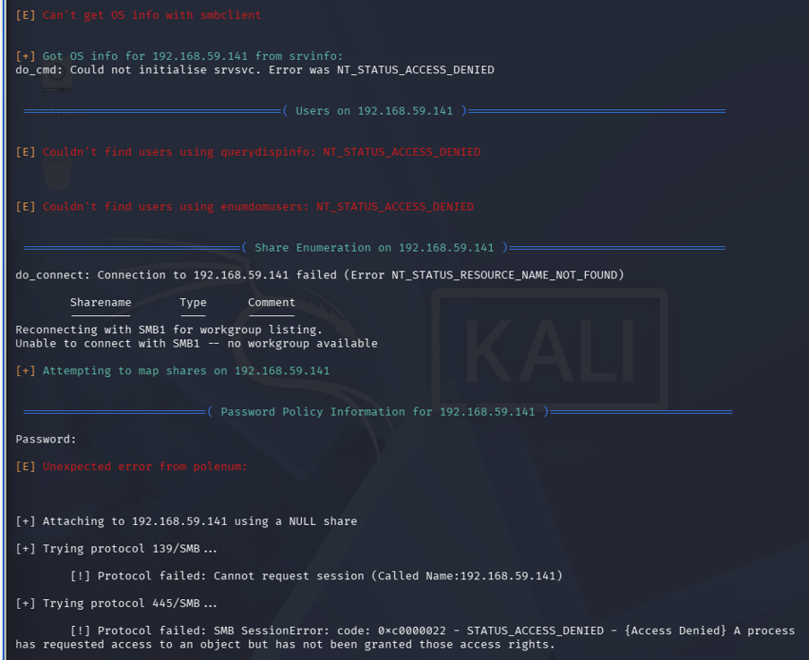
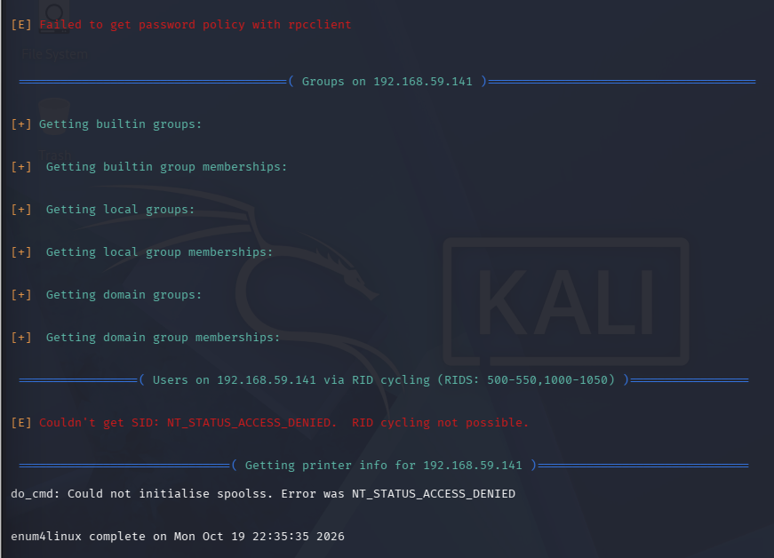
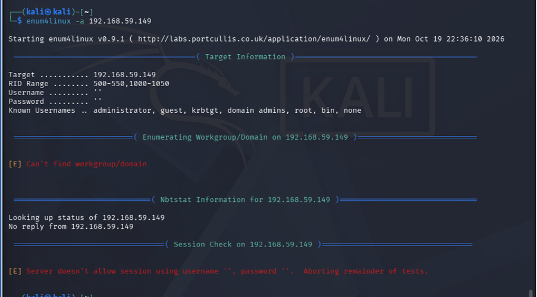

# Week 4 Lab Report: SMB and NetBIOS Enumeration via enum4linux

## Overview
This laboratory exercise covers automated SMB and NetBIOS enumeration using `enum4linux` across three distinct operating system targets (Metasploitable 2, Windows 7, and Ubuntu).

## Definition
Enumeration in this lab context refers to the active phase of gathering detailed system information—such as user accounts, shared network directories, domain structures, and password policies—by querying open service ports like Server Message Block (SMB) and NetBIOS.

---

## Command Breakdown Reference
The enumeration command and flags used during this laboratory exercise are detailed below:

| Command / Flag | Description |
| :--- | :--- |
| enum4linux | A command-line tool used for enumerating information from Windows and Samba hosts |
| -a | Performs all enumeration options (such as share listing, user extraction, and password policy checks) |
| sudo | Executes commands with elevated administrative privileges |

---

## Task 1: Metasploitable 2 Enumeration (192.168.59.135)

### a. Target Enumeration
- **Command**: `enum4linux -a 192.168.59.135` (Recon command)
- **Result**: The tool successfully connected to Metasploitable 2 via an unauthenticated null session, revealing Samba version 3.0.20-Debian, workgroup name `WORKGROUP`, and mapping open shares such as `/tmp` with full read and write access.
- **Meaning**: The target runs an insecure legacy Samba server configuration that permits anonymous IPC connections without requiring valid user credentials.
- **How Attackers Use This**: Attackers leverage anonymous null sessions to harvest user account lists via Relative Identifier (RID) cycling and inspect readable shares for sensitive file disclosures or malicious payload drops.
- **How to Patch**: Upgrade Samba to a supported secure release and disable anonymous null session guest access in `smb.conf`.

Figure 4.1: `enum4linux` output showing null session access, Samba version, user accounts, and share mappings on Metasploitable 2.

---

## Task 2: Windows 7 Enumeration (192.168.59.141)

### a. Target Enumeration
- **Command**: `enum4linux -a 192.168.59.141` (Recon command)
- **Result**: The tool successfully queried basic NetBIOS computer name details (`WIN-4VV79LP18NO`) via a baseline transport connection, but all subsequent Remote Procedure Call (RPC) requests returned explicit `NT_STATUS_ACCESS_DENIED` errors.
- **Meaning**: Windows 7 implements strict security boundaries that isolate Local Security Authority (LSA) and Security Account Manager (SAM) databases from unauthenticated network users.
- **How Attackers Use This**: Attackers attempt to extract local user lists and password rules, but hardened Windows access controls block unauthorized information gathering.
- **How to Patch**: Maintain default Windows firewall profiles and ensure network access restrictions are enforced against unauthenticated enumeration.

Figure 4.2: `enum4linux` execution against Windows 7 showing blocked RPC queries and access denied responses.

---

## Task 3: Ubuntu Enumeration (192.168.59.149)

### a. Target Enumeration
- **Command**: `enum4linux -a 192.168.59.149` (Recon command)
- **Result**: The enumeration scan failed entirely across all phases, returning errors indicating that the server does not allow null sessions and that workgroups could not be found.
- **Meaning**: Ubuntu does not run Samba or NetBIOS file-sharing daemons by default, leaving SMB ports closed and refusing anonymous connections.
- **How Attackers Use This**: Attackers find no exposed SMB or NetBIOS attack surface, forcing them to pivot reconnaissance efforts to other open services.
- **How to Patch**: Keep unnecessary file-sharing services disabled on Linux servers unless explicitly required for network operations.

Figure 4.3: `enum4linux` execution against Ubuntu demonstrating complete scan abortion due to inactive SMB ports.

---

## Summary

The table below summarises the enumeration capabilities and security postures observed across all three target operating systems:

| Target Host | IP Address | SMB / NetBIOS State | Null Session Allowed | Disclosed Information | Conclusion |
| :--- | :--- | :--- | :--- | :--- | :--- |
| Metasploitable 2 | 192.168.59.135 | Active (Samba 3.0.20) | Yes (Full Access) | Samba Version, 35+ Local/Domain Users, `/tmp` share access, Password Policies | Insecure legacy configuration allows complete anonymous network reconnaissance and account harvesting via IPC$. |
| Windows 7 | 192.168.59.141 | Active (Windows SMB) | Partial (Transport Only, RPC Blocked) | Hostname (`WIN-4VV79LP18NO`) and Workgroup name (`WORKGROUP`) only | Hardened against Null Sessions: Restricts anonymous LSA/SAM access, returning `ACCESS_DENIED` to prevent user account and share extraction. |
| Ubuntu | 192.168.59.149 | Inactive / Not Installed | No (Connection Refused) | None (Scan aborted) | Minimized Surface Area: Absence of default SMB/NetBIOS services eliminates file-sharing attack vectors entirely. |

---

## How to Mitigate

**While default security configurations on modern operating systems help block unauthorized reconnaissance, robust hardening practices must be applied to prevent internal enumeration and credential harvesting.**

The table below outlines modern countermeasures to mitigate SMB and NetBIOS enumeration:

| Lab Finding & Vulnerability | Modern Defense & Countermeasure |
| :--- | :--- |
| Anonymous Null Session Access on Samba | Disable guest access and null sessions in Samba configuration files (`map to guest = Never`). |
| User Account Harvesting via RID Cycling | Restrict anonymous SAM/LSA account enumeration using local security policy settings. |
| Exposed NetBIOS Name Service (UDP 137) | Disable NetBIOS over TCP/IP on network adapters where legacy file sharing is not required. |
| Unrestricted SMB Share Permissions | Audit and enforce strict access control lists (ACLs) on all network file shares to prevent anonymous write access. |
