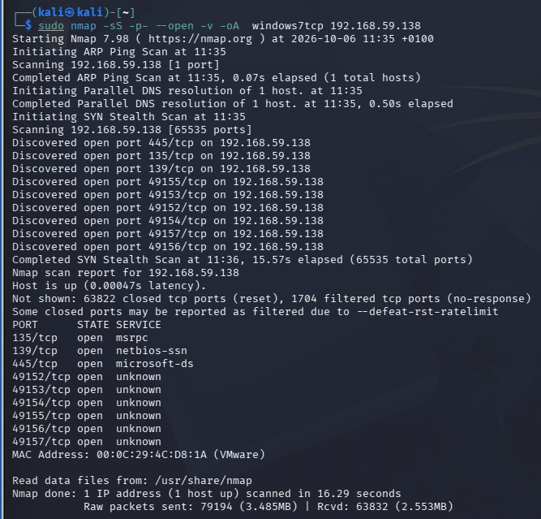
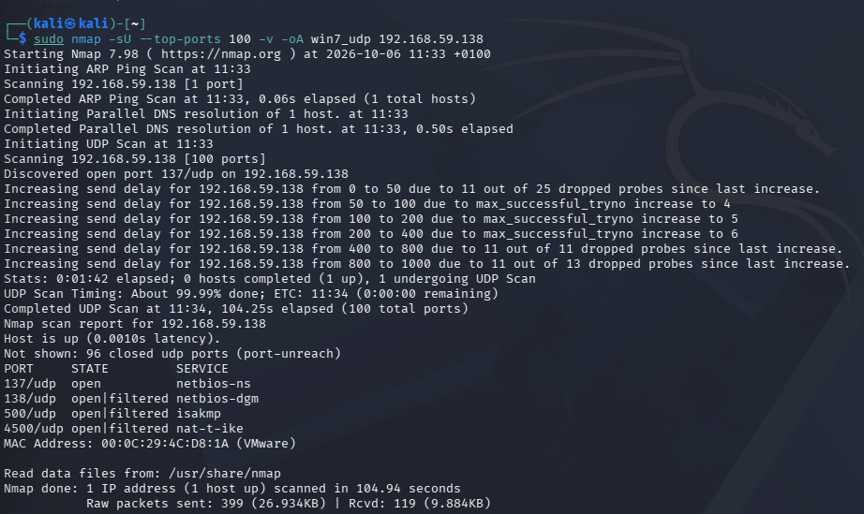
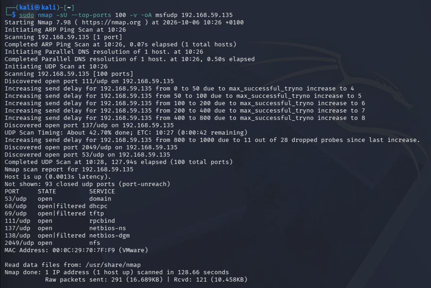
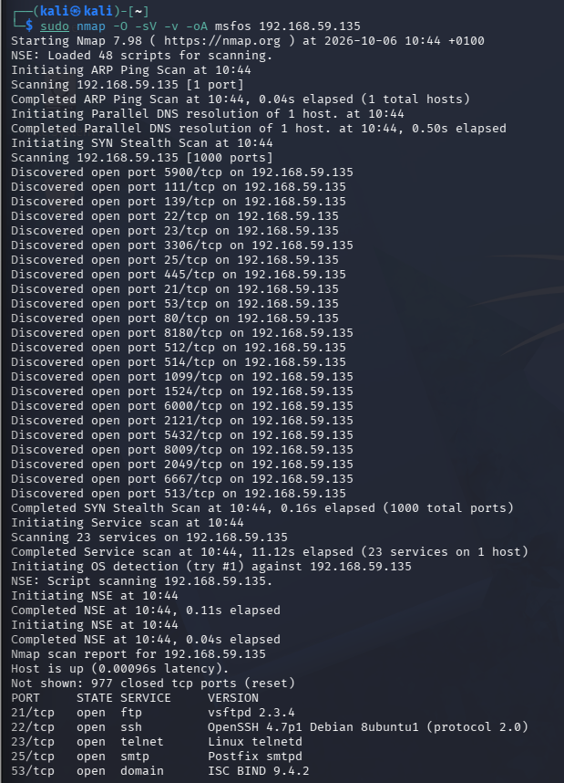
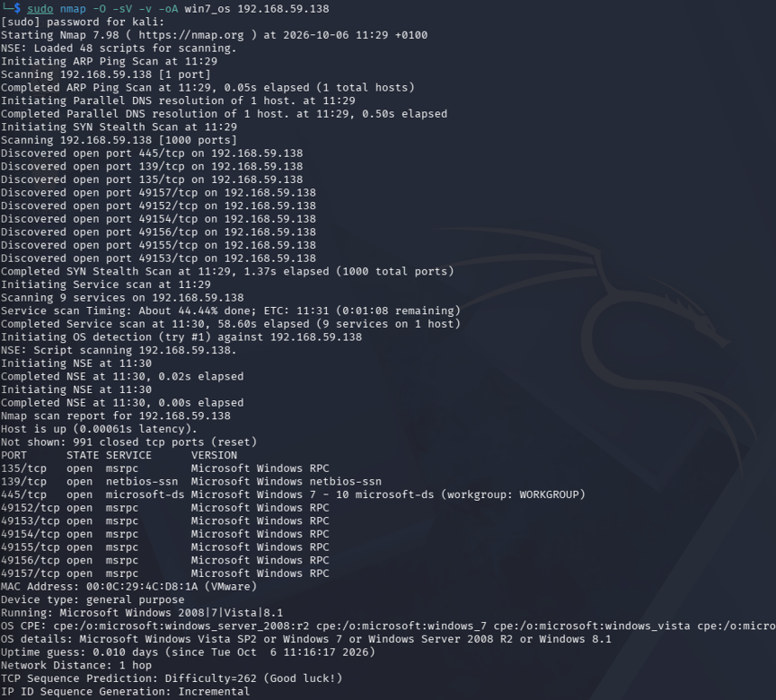

# Week 2 Lab Report: Footprinting and Reconnaissance

## Overview
This laboratory exercise covers active network reconnaissance and target footprinting using Nmap. 

## Definition 
Reconnaissance is the discovery phase used to identify live hosts, network boundaries, and open ports, whereas fingerprinting is the deeper analysis phase used to extract exact operating system versions and software services from those open ports. 

---

## Command Breakdown Reference
The Nmap commands used during this lab exercise are detailed below:

| Command | Description |
| :--- | :--- |
| sudo | Executes Nmap with administrative privileges  |
| -sS | Performs a TCP SYN stealth scan without completing full TCP handshakes |
| -sU | Performs a UDP port scan |
| -p- | Scans all 65,535 TCP ports on the target host |
| --top-ports 100 | Limits the UDP scan to the 100 most common UDP service ports |
| -O | Enables operating system fingerprinting through TCP/IP stack analysis |
| -sV | Scans open network ports to determine service name and software version |
| -v | Enables verbose mode to display real-time scan progress |
| -oA | Saves scan output in normal, XML, and grepable log formats |

---

## Task 1: TCP Port Scanning (-sS)

### a. Windows 7 (192.168.59.138)
* **Command**: `sudo nmap -sS -p- --open -v -oA windows7tcp 192.168.59.138` (Recon command)
* **Result**: The full TCP scan found 9 open ports. These include RPC (Remote Procedure Call) on port 135, NetBIOS (Network Basic Input/Output System) on port 139, SMB (Server Message Block) on port 445, and dynamic RPC ephemeral ports 49152 through 49157.
* **Meaning**: Windows SMB and RPC services are open to the local network. These protocols handle network communication, file sharing, and remote administrative functions.
* **How Attackers Use This**: An attacker can query SMB and RPC to list shared drives, gather system user accounts, or attempt credential relay attacks such as NTLM relaying. Exposed SMB services on legacy systems can also be targeted with automated exploitation tools like EternalBlue (MS17-010).
* **How to Patch**: Disable SMBv1 and block TCP ports 135, 139, and 445 at the host firewall level.

Figure 2.1: Nmap SYN stealth scan output showing open TCP ports on Windows 7.

### b. Metasploitable 2 (192.168.59.135)
* **Command**: `sudo nmap -sS -p- --open -v -oA msfwtcp 192.168.59.135` (Recon command)
* **Result**: The scan revealed a large attack surface with open ports including FTP (21), SSH (22), Telnet (23), SMTP (25), DNS (53), HTTP (80), RPCbind (111), SMB (139/445), and MySQL (3306).
* **Meaning** : The host runs many unencrypted and outdated network daemons without access controls or network filtering.
* **How Attackers Use This**: Unencrypted protocols like Telnet transmit credentials in cleartext that can be sniffed on the network. Outdated software versions can be cross-referenced with public exploit databases (such as Exploit-DB) to launch direct remote code execution attacks.
* **How to Patch**: Stop unnecessary network services using `systemctl disable <service>` and replace cleartext protocols like Telnet with SSH.

Figure 2.2: Nmap full port TCP SYN scan displaying open service ports on Metasploitable 2.

---

## Task 2: UDP Port Scanning (-sU)

### a. Windows 7 (192.168.59.138)
* **Command**: `sudo nmap -sU --top-ports 100 -v -oA win7_udp 192.168.59.138` (Recon command)
* **Result**: The scan discovered open and open-filtered UDP ports including NetBIOS Name Service (137/udp), NetBIOS Datagram Service (138/udp), ISAKMP (500/udp), and NAT-T IPsec (4500/udp).
* **Meaning** : NetBIOS UDP services listen for local hostname resolution queries on the network segment.
* **How Attackers Use This**: Attackers can listen for unmanaged NetBIOS broadcast traffic on the local network and use spoofing tools like Responder to trick the host into sending authentication hashes.
* **How to Patch**: Disable NetBIOS over TCP/IP inside the Windows Network Adapter Advanced TCP/IP settings.

Figure 2.3: Top 100 UDP port scan on Windows 7 showing NetBIOS and IPsec service ports.

### b. Metasploitable 2 (192.168.59.135)
* **Command**: `sudo nmap -sU --top-ports 100 -v -oA msfudp 192.168.59.135` (Recon command)
* **Result**: Discovered open UDP services including DNS (53), TFTP (69), RPCbind (111), NetBIOS (137), and NFS (2049).
* **Meaning**: The host exposes legacy file transfer and remote file system protocols over UDP without authentication.
* **How Attackers Use This**: Trivial File Transfer Protocol (TFTP) on port 69 has no authentication, allowing an attacker to download sensitive system configuration files. NFS shares on port 2049 can often be mounted directly by an attacker to read or write files on the target filesystem.
* **How to Patch**: Restrict NFS share exports in `/etc/exports` by restricting IP permissions and disable unauthenticated TFTP services.

Figure 2.4: UDP port scan identifying file sharing and naming services on Metasploitable 2.

---

## Task 3: OS Detection and Version Fingerprinting (-O, -sV)

### a. Metasploitable 2 Fingerprinting
* **Command**: `sudo nmap -O -sV -v -oA msfos 192.168.59.135` (Fingerprinting command)
* **Result**: Identified the operating system as Linux 2.6.X (versions 2.6.9 through 2.6.33). Service version probes identified specific software versions such as vsftpd 2.3.4, OpenSSH 4.7p1, Apache httpd 2.2.8, and a root bindshell on port 1524.
* **Meaning** : Version fingerprinting reveals exact software builds, including known backdoor installations like vsftpd 2.3.4 and an unauthenticated administrative command shell on port 1524.
* **How Attackers Use This**: An attacker can connect directly to port 1524 using Netcat (`nc 192.168.59.135 1524`) to gain an immediate root command shell without needing a password.
* **How to Patch**: Terminate the malicious bindshell process and update vsftpd and OpenSSH daemons to supported repository packages.

Figure 2.5: OS and service version detection output for Metasploitable 2.

### b. Windows 7 Fingerprinting
* **Command**: `sudo nmap -O -sV -v -oA win7_os 192.168.59.138` (Fingerprinting command)
* **Result**: Identified the operating system as Microsoft Windows Vista SP2, Windows 7, or Windows Server 2008 R2. Service probes confirmed Microsoft-ds SMB services running under the default WORKGROUP domain.
* **Meaning** : The target is running an end-of-life Windows operating system that no longer receives security updates from Microsoft.
* **How Attackers Use This**: Attackers map the exact Windows kernel version to select pre-packaged exploit modules inside Metasploit, targeting unpatched kernel drivers or SMB flaws.
* **How to Patch**: Upgrade the system to a supported operating system version such as Windows 10, Windows 11, or Windows Server 2022.

Figure 2.6: OS and service fingerprinting results for Windows 7.

---

## Countermeasures & Mitigation Summary

While Metasploitable 2 and Windows 7 are intentionally vulnerable systems used for learning, similar misconfigurations still appear in real production environments due to legacy software dependency, poor network management, and default installations. 

The table below summarises how each finding from this lab can be patched in modern environments:

| Lab Finding & Vulnerability | Modern Defense & Countermeasure |
| :--- | :--- |
| Exposed SMB Ports (139/445) | Enforce SMB Signing, disable legacy SMBv1, and restrict port 445 access using firewalls. |
| Cleartext Services (Telnet/TFTP) | Disable Telnet and TFTP; enforce encrypted management alternatives like SSH and SFTP. |
| Unauthenticated Root Shell (Port 1524) | Terminate unnecessary listening processes and conduct regular internal port audits. |
| NetBIOS Broadcast Leaks (UDP 137/138) | Disable NetBIOS over TCP/IP and LLMNR across corporate networks via Group Policy (GPO). |
| Outdated Operating System & Daemons | Implement an automated patch management and upgrade end-of-life operating systems. |
